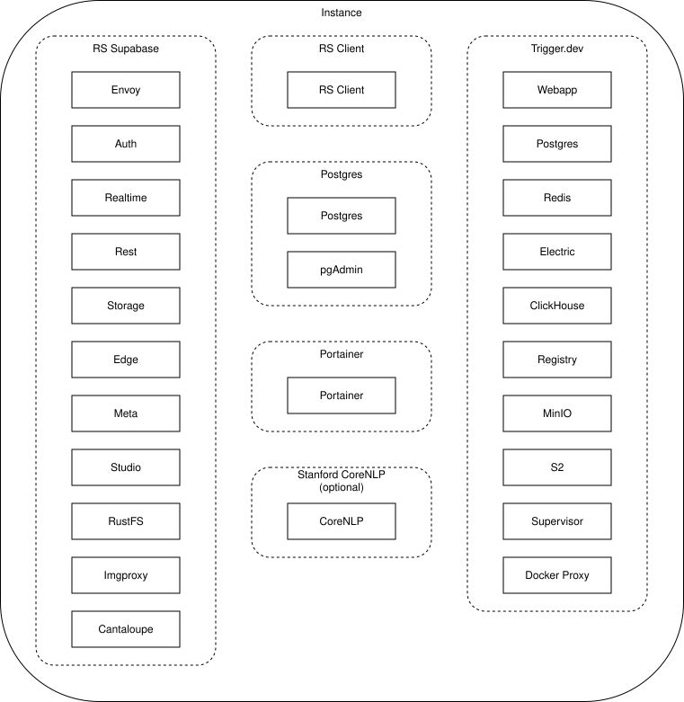
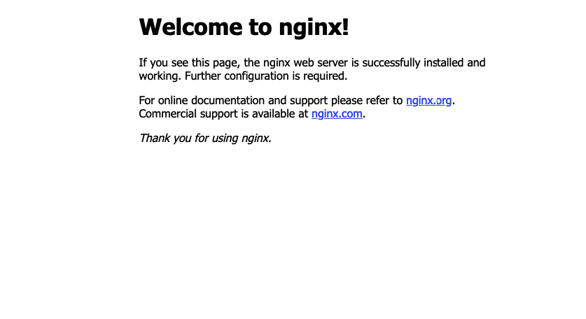

import { Badge } from '@astrojs/starlight/components';

:::note[Documentation Version]
This guide is written for **Recogito Studio v1.12** and later. If you're working with an earlier version, some steps may differ.
:::

These instructions cover self-hosting Recogito Studio with [Docker](https://www.docker.com/), [Docker Compose](https://docs.docker.com/compose/), and [Nginx](https://nginx.org). Because everything runs in Docker behind Nginx, you can use any server that meets the [system requirements](#system-requirements), including a cloud VM (DigitalOcean, AWS EC2, Hetzner, Linode, etc.) or your own hardware. The steps assume a Debian-based distribution and were written against Ubuntu 26.04 LTS; many earlier versions will likely work as well.

## System Architecture

Self-hosted Recogito Studio runs as a set of Docker containers: the Astro client, a Supabase/Postgres backend (with RustFS object storage and a Cantaloupe IIIF server), and Portainer for container management. See the [architecture overview](/guides/overview/#architecture-overview) for the high-level model, or the [reference docs](/reference/server-architecture/) for detail.



### Additional Services

- **Trigger.dev** — Background job system required for project import/export. See [Set Up Trigger.dev](#set-up-triggerdev).
- **Stanford CoreNLP** — Natural language processor (optional). This is reqiured for the [NER plugin](https://github.com/recogito/plugin-ner). The NER plugin also requires its own Trigger.dev project, with that project's secret key set in `TRIGGER_NER_SECRET_KEY`. See [the NER plugin's README](https://github.com/recogito/plugin-ner).

### Domains and DNS

Point the hostnames you use at your server's public IP with DNS `A` records (or a single wildcard record). Two services are used by your end users' browsers and **must** be reachable at a public hostname:

- `client.example.com` — Client application
- `server.example.com` — Supabase API, which the client calls directly

The other three are operator-only management UIs. Give them hostnames if you want browser access over HTTPS, or skip public DNS and reach them privately (over an SSH tunnel, or by IP and port) to reduce your attack surface:

- `portainer.example.com` — Container management
- `pgadmin.example.com` — Database administration
- `rustfs.example.com` — Object storage console

If you [self-host Trigger.dev](#set-up-triggerdev) and expose it over the web, add one more, such as `trigger.example.com`.

The subdomain names are conventions, not requirements. You choose the base domain and the hostnames—they are wired up through your `.env` (`SITE_URL`, `API_EXTERNAL_URL`) and the Nginx site configs, so nothing is hardcoded.

## System Requirements

- **Operating System**: Ubuntu 26.04 LTS recommended; other Debian-based distributions should work
- **CPU**: Minimum 2 CPUs
- **Memory**: Minimum 4GB
- **Storage**: 80GB+ recommended
- **Network**: Public IP address with DNS access
- **SSH**: enabled

## Installation Steps

### 1. Create and Secure Your Server

#### Provision a Server

Provision a server that meets the [system requirements](#system-requirements). Note its public IP address, and enable automatic backups for production use.

> New to cloud servers? DigitalOcean's [droplet creation guide](https://docs.digitalocean.com/products/droplets/how-to/create/) is a good starting point, but any provider or on-premises machine works.

#### Set Up Non-Root User and Firewall

These steps follow DigitalOcean's [initial server setup guide](https://www.digitalocean.com/community/tutorials/initial-server-setup-with-ubuntu). Connect to your server:

```bash
ssh root@your_server_ip
```

Update the system:

```bash
apt update
apt upgrade
```

Create a new `recogito` user with sudo privileges:

```bash
adduser recogito
usermod -aG sudo recogito
```

Configure the UFW firewall:

```bash
ufw app list
ufw allow OpenSSH
ufw enable
ufw status
```

If your provider has its own firewall or security groups (AWS, GCP, etc.), apply the equivalent rules there as well—some clouds block ports upstream regardless of UFW.

Best practice is to not utilize the `root` login except in special circumstances. Go ahead and exit the instance and SSH in with the new `recogito` user.

```bash
exit
ssh recogito@your_server_ip
```

### 2. Install Nginx

Install and configure the web server:

```bash
sudo apt update
sudo apt install nginx
```

Adjust firewall for web traffic:

```bash
sudo ufw allow 'Nginx Full'
sudo ufw status
```

Verify Nginx is running:

```bash
systemctl status nginx
```

Test by navigating to `http://your_server_ip` - you should see the Nginx welcome page.



### 3. Install Dependencies

#### Git

Verify Git is installed:

```bash
git --version
```

#### Docker

Install Docker Engine and the Compose plugin by following [Docker's official install instructions](https://docs.docker.com/engine/install/) for your distribution. On Ubuntu, the quickest option is the convenience script:

```bash
curl -fsSL https://get.docker.com | sudo sh
```

#### Node.js

Recogito recommends Node.js 26 LTS. The version in your distribution's repository is likely older. We recommend following the instructions on [the NodeSource distribution page](https://nodesource.com/products/distributions) to install Node 26.

Double check you're running Node 26:

```bash
node --version
```

### 4. Clone and Configure Recogito Studio

Clone the repository:

```bash
git clone --depth 1 https://github.com/recogito/recogito-studio.git
cd ./recogito-studio
```

Copy and edit environment variables:

```bash
cp ./docker/.env.example ./docker/.env
nano ./docker/.env
```

Copy the default config:

```bash
cp ./docker/config/config.json ./docker/config/config.local.json
```

You may wish to update `config.local.json` with your branding, such as site name, colors, etc.

### 5. Critical Environment Variables

Update these required values in your `.env` file:

#### Passwords and Secrets

Some values are **passwords you choose** (you'll log in with them); the rest are **random secrets** you generate with a command and never type by hand.

All passwords in this file should avoid [characters that break Bash scripts](https://mywiki.wooledge.org/BashGuide/SpecialCharacters). If you're using a password generator, make sure to disable special characters.

Logins and passwords you choose:

- `DASHBOARD_PASSWORD` <Badge text="required" variant="caution" size="small" /> — Supabase Studio login (must include at least one letter)
- `DASHBOARD_USERNAME` <Badge text="optional" variant="note" size="small" /> — username for the Supabase Studio login. Defaults to `supabase`.
- `ORG_ADMIN_PW` <Badge text="required" variant="caution" size="small" /> — password for the initial admin user (`admin@example.com`)
- `S3_ACCESS_KEY` / `S3_SECRET_KEY` <Badge text="required" variant="caution" size="small" /> — your login for the RustFS object storage console. The secret key must be at least 8 characters.
- `PGADMIN_ADMIN_EMAIL` / `PGADMIN_ADMIN_PASSWORD` <Badge text="required" variant="caution" size="small" /> — your login for pgAdmin. The email must be a valid address format, or the container won't start.

Random secrets (run the command and paste the output):

- `POSTGRES_PASSWORD` <Badge text="required" variant="caution" size="small" /> — `openssl rand -hex 24` (hex avoids characters that break Postgres connection strings)
- `VAULT_ENC_KEY` <Badge text="required" variant="caution" size="small" /> — `openssl rand -hex 16` (32 characters)
- `INVITE_CRYPTO_KEY` <Badge text="required" variant="caution" size="small" /> — `openssl rand -base64 32`
- `ROOM_SECRET` <Badge text="required" variant="caution" size="small" /> — `openssl rand -base64 24`

Identifier:

- `POOLER_TENANT_ID` <Badge text="required" variant="caution" size="small" /> — any unique string, e.g. `recogito`

#### JWT Secret and API Keys

Recogito uses Supabase's legacy JWT-based keys. First, generate a `JWT_SECRET` and set it in your `.env`:

```bash
openssl rand -base64 36
```

`ANON_KEY` and `SERVICE_ROLE_KEY` are JWTs signed with that secret. From your `recogito-studio` directory, with `JWT_SECRET` already set in `docker/.env`:

```bash
JWT_SECRET="$(grep '^JWT_SECRET=' docker/.env | cut -d= -f2-)" node -e '
const c = require("crypto");
const iat = Math.floor(Date.now() / 1000);
const exp = iat + 60 * 60 * 24 * 365 * 10; // 10 years
const enc = (o) => Buffer.from(JSON.stringify(o)).toString("base64url");
const sign = (role) => {
  const data = enc({ alg: "HS256", typ: "JWT" }) +
    "." + enc({ role, iss: "supabase", iat, exp });
  return data + "." + c.createHmac("sha256", process.env.JWT_SECRET).update(data).digest("base64url");
};
console.log("ANON_KEY=" + sign("anon"));
console.log("SERVICE_ROLE_KEY=" + sign("service_role"));
'
```

Copy the two printed values into `ANON_KEY` and `SERVICE_ROLE_KEY` in your `.env`.

#### URLs

- `SITE_URL` <Badge text="required" variant="caution" size="small" /> — your client domain (`https://client.example.com`)
- `API_EXTERNAL_URL` <Badge text="required" variant="caution" size="small" /> — your server domain (`https://server.example.com`)

#### Background Jobs (Trigger.dev)

See [Set Up Trigger.dev](#set-up-triggerdev) for how to obtain these.

- `TRIGGER_PROJECT_ID` <Badge text="required" variant="caution" size="small" /> — project ref from the Trigger.dev dashboard
- `TRIGGER_SECRET_KEY` <Badge text="required" variant="caution" size="small" /> — secret key from the Trigger.dev dashboard
- `TRIGGER_SERVER_URL` <Badge text="optional" variant="note" size="small" /> — your instance URL; only when self-hosting Trigger.dev. Omit to use Trigger.dev Cloud.
- `TRIGGER_NER_SECRET_KEY` <Badge text="optional" variant="note" size="small" /> — secret key of the NER plugin's separate Trigger.dev project; only when using the [NER plugin](#additional-services)

#### Email (SMTP)

The stack does **not** include a mail server. The `.env.example` defaults (`SMTP_HOST=supabase-mail`) point at a placeholder that doesn't exist, so **user invites and password resets will not be delivered until you configure a real SMTP provider** (e.g. Amazon SES, SendGrid, Mailgun, or your own mail server).

Set these to your provider's credentials:

- `SMTP_HOST` / `SMTP_PORT` <Badge text="required" variant="caution" size="small" /> — your provider's server and port
- `SMTP_USER` / `SMTP_PASS` <Badge text="required" variant="caution" size="small" /> — your provider's credentials
- `SMTP_SENDER_NAME` <Badge text="required" variant="caution" size="small" /> — display name on outgoing mail
- `SMTP_ADMIN_EMAIL` / `MAIL_FROM_ADDRESS` <Badge text="required" variant="caution" size="small" /> — the "from" address (use one your provider is authorized to send from)
- `ENABLE_EMAIL_AUTOCONFIRM` <Badge text="optional" variant="note" size="small" /> — set to `true` to activate new signups immediately without a confirmation email. Defaults to `false`, which emails each new user a confirmation link they must click (requires working SMTP).
- `DISABLE_SIGNUP` <Badge text="optional" variant="note" size="small" /> — set to `true` for a closed instance where only invited users can create accounts.
- `PUBLIC_ENABLE_USER_INVITE` <Badge text="optional" variant="note" size="small" /> — controls whether org admins can invite users from the User Management UI. Defaults to `TRUE`; set to `FALSE` to hide the invite feature.

#### SAML Single Sign-On

Recogito offers the ability to connect users via SAML: [Set Up SAML Single Sign-On](#set-up-saml-single-sign-on).

- `SAML_ENABLED` <Badge text="optional" variant="note" size="small" /> — set to `true` to enable SAML sign-in
- `SAML_PRIVATE_KEY` <Badge text="optional" variant="note" size="small" /> — the private key Recogito Studio will use to sign SAML requests. Required when `SAML_ENABLED` is `true`.

#### Plugins

- `INSTALLED_PLUGINS` <Badge text="optional" variant="note" size="small" /> — plugins to install and compile into the client, as a comma- or space-separated list of NPM package names or GitHub repositories. See the [Plugins guide](/guides/plugins/) for the entry format and the available packages.

#### Test Banner

- `PUBLIC_TEST_BANNER` <Badge text="optional" variant="note" size="small" /> — set to `true` to show a banner on every page warning that this is a test environment and any data is temporary. Defaults to `false`.

#### Duplicated variables

Some values need to be duplicated in other parts of the `.env` file.

- `PUBLIC_SUPABASE` <Badge text="required" variant="caution" size="small" /> - copy the value from `API_EXTERNAL_URL`
- `PUBLIC_SUPABASE_API_KEY` <Badge text="required" variant="caution" size="small" /> - copy the value from `ANON_KEY`
- `PUBLIC_IIIF_CANTALOUPE_PATH` <Badge text="required" variant="caution" size="small" /> - copy `API_EXTERNAL_URL` and append `/iiif/2`
- `SUPABASE_SERVICE_KEY` <Badge text="required" variant="caution" size="small" /> - copy the value from `SERVICE_ROLE_KEY`

### 6. Configure Nginx Routes

Each hostname you expose ([see above](#domains-and-dns)) needs its own `nginx` site configuration. The repo provides a template for each one. You can customize these to fit your needs or roll your own `nginx` setup.

#### Client Configuration

```bash
sudo cp ./nginx.client.example.com /etc/nginx/sites-available/<your client url>
sudo nano /etc/nginx/sites-available/<your client url>
```

Replace `client.example.com` with your actual client domain.

#### Server Configuration

```bash
sudo cp ./nginx.server.example.com /etc/nginx/sites-available/<your server url>
sudo nano /etc/nginx/sites-available/<your server url>
```

Update:

- `server_name` with your server URL
- `Access-Control-Allow-Origin` headers with your client URL

#### Support Services

Repeat for whichever of the operator-only services you are exposing at a hostname. Skip any that you don't intend to access from the public internet.

```bash
sudo cp ./nginx.rustfs.example.com /etc/nginx/sites-available/<your RustFS url>
sudo cp ./nginx.pgadmin.example.com /etc/nginx/sites-available/<your pgAdmin url>
sudo cp ./nginx.portainer.example.com /etc/nginx/sites-available/<your Portainer url>
```

In each file, replace the example hostname in both `server_name` and the `Access-Control-Allow-Origin` header with your own.

#### Update nginx.conf

Add WebSocket support to `/etc/nginx/nginx.conf`:

```bash
sudo nano /etc/nginx/nginx.conf
```

Add to http block:

```nginx
map $http_upgrade $connection_upgrade {
    default upgrade;
    '' close;
}
```

#### Enable Sites

Create a symbolic link for each site you configured:

```bash
sudo ln -s /etc/nginx/sites-available/<your server url> /etc/nginx/sites-enabled/
sudo ln -s /etc/nginx/sites-available/<your client url> /etc/nginx/sites-enabled/
sudo ln -s /etc/nginx/sites-available/<your pgAdmin url> /etc/nginx/sites-enabled/
sudo ln -s /etc/nginx/sites-available/<your RustFS url> /etc/nginx/sites-enabled/
sudo ln -s /etc/nginx/sites-available/<your Portainer url> /etc/nginx/sites-enabled/
```

Test and restart:

```bash
sudo nginx -t
sudo systemctl restart nginx
```

### 7. SSL Certificates with Let's Encrypt

Install Certbot by following the [official Certbot instructions](https://certbot.eff.org/instructions?ws=nginx&os=snap) for Nginx on Ubuntu, then issue a certificate for each hostname you configured:

```bash
sudo certbot --nginx -d <your client url>
sudo certbot --nginx -d <your server url>
sudo certbot --nginx -d <your pgAdmin url>
sudo certbot --nginx -d <your RustFS url>
sudo certbot --nginx -d <your portainer url>
```

Certbot installs a timer to renew certificates automatically. Confirm it works with `sudo certbot renew --dry-run`.

### 8. Run Installation

If you want project import/export, finish steps 1 and 2 of [Set Up Trigger.dev](#set-up-triggerdev) first so the client starts with your Trigger.dev values. If you are using SAML, finish steps 1 and 2 of [Set Up SAML Single Sign-On](#set-up-saml-single-sign-on) first.

Execute the installation script:

```bash
sudo bash ./install-self-hosted-docker.sh
```

## Set Up Trigger.dev

Recogito Studio runs **project import and export** as background jobs on [Trigger.dev](https://trigger.dev/), so a Trigger.dev project is required for those features (annotation and the rest of the app work without it). You can use **managed Trigger.dev Cloud** or **self-host** your own instance. Complete this before running the install script so the client starts with the correct values, or restart the `client` container afterward.

1. **Get a Trigger.dev instance.**

   - _Managed:_ sign up for [Trigger.dev Cloud](https://trigger.dev/).
   - _Self-hosted:_ follow the [Trigger.dev Docker guide](https://trigger.dev/docs/self-hosting/docker) (see the [self-hosting overview](https://trigger.dev/docs/self-hosting/overview) for architecture). Run it on the same or a separate server; to reach it over the web, proxy it with Nginx + TLS at a hostname such as `trigger.example.com`. Pin the instance to a version compatible with the client's `@trigger.dev/sdk` (see [`package.json`](https://github.com/recogito/recogito-client/blob/main/package.json)).

2. **Create a project** in the Trigger.dev dashboard and generate a secret key, then set the [Trigger.dev variables](#background-jobs-triggerdev) in `docker/.env`.

3. **Deploy the import/export tasks** to your project. This is done from a checkout of [`recogito-client`](https://github.com/recogito/recogito-client), which is a different repo from `recogito-studio` (the install script only clones it temporarily):

   ```bash
   git clone --single-branch --branch main --depth 1 https://github.com/recogito/recogito-client.git
   cd recogito-client
   npm install
   ```

   The deploy reads its settings from a `.env` file in that checkout and copies the service key into your Trigger.dev project, so create one with the same values as your `docker/.env`:

   ```bash
   TRIGGER_PROJECT_ID=proj_...          # same as docker/.env
   SUPABASE_SERVICE_KEY=...             # same as docker/.env
   # IIIF_KEY=...                       # only if you use FairImage instead of the bundled Cantaloupe
   ```

   Then log in and deploy:

   ```bash
   npx trigger.dev@latest login          # self-hosted: add -a https://trigger.example.com
   npx trigger.dev@latest deploy -c ./trigger.config.ts
   ```

   Self-hosted deploys also require Docker registry access—see the [Trigger.dev deployment docs](https://trigger.dev/docs/self-hosting/docker) for the `docker login` step.

   Redeploy the tasks after each Recogito Studio upgrade so they match the client version.

## Set Up SAML Single Sign-On

Recogito Studio can sign users in through a SAML 2.0 identity provider (IdP), such as your institution's Shibboleth, Microsoft Entra ID, Okta, or Keycloak. The first time someone signs in this way, Recogito Studio creates their account and adds them to the default organization group.

:::caution
Recogito does not support switching an existing instance to SAML, or vice versa. If you attempt to do this, user accounts with the same email addresses as existing accounts will be duplicated.
:::

Sign-in must start from the Recogito Studio login page.

You'll need:

- Someone who can register a new application (a "service provider") with your IdP
- The email domain or domains your users sign in with, such as `university.edu`
- The names of the SAML attributes your IdP sends for email, first name, and last name.
- `jq` on the server, to run the setup script (`sudo apt install jq`)

### 1. Generate a signing key and enable SAML

Generate a key:

```bash
openssl genrsa 2048 | openssl rsa -outform DER -traditional | base64 | tr -d '\n'
```

On macOS, remove `-traditional` from the command.

Add the output to `docker/.env` and turn SAML on:

```bash
SAML_ENABLED=true
SAML_PRIVATE_KEY=MIIEow...   # the output from the command above
```

Keep a copy of this key with your other secrets. If you replace it, give your IdP the updated metadata from Step 3.

### 2. Add the sign-in button

The login page shows a button for each method in the `authentication` section of your config. Create `docker/config/config.local.json` if you haven't already (see [Step 4](#4-clone-and-configure-recogito-studio)), then add a `saml` method:

```json
"authentication": {
  "methods": [
    {
      "name": "Sign in with Username and Password",
      "type": "username_password"
    },
    {
      "name": "Sign in with University SSO",
      "type": "saml",
      "domain": "university.edu"
    }
  ]
}
```

`domain` must be one of the domains you plan to register in [Step 4](#4-register-your-idp) below.

**Note: If you keep the `username_password` method available, SAML users and username/password users will be duplicated if they use the same email. `username_password` is also required in order to log in with the default admin account whose password you set with `ORG_ADMIN_PW`.**

### 3. Install, then give your IdP the service provider details

Run the install script ([Step 8](#8-run-installation)).

Service provider metadata is available at:

```
https://server.example.com/auth/v1/sso/saml/metadata
```

Open it in a browser to check that it loads. Give this URL to your IdP administrator. If your IdP wants the ACS URL, it is available at:

```
https://server.example.com/auth/v1/sso/saml/acs
```

Your IdP must:

- Send a **persistent** NameID
- Release the user's email address, first name, and last name as attributes

Make a note of your IdP's metadata URL.

### 4. Register your IdP

From the root of the `recogito-studio` repository, run `manage-saml-provider.sh`. It reads the server address and `SERVICE_ROLE_KEY` from `docker/.env`. With a metadata URL:

```bash
./manage-saml-provider.sh add \
  --metadata-url https://idp.university.edu/metadata \
  --domains university.edu \
  --email-attr mail \
  --first-name-attr givenName \
  --last-name-attr sn
```

Replace `mail`, `givenName`, and `sn` with the attribute names your IdP sends. Common alternatives are long URNs such as `urn:oid:0.9.2342.19200300.100.1.3`. If you leave out `--email-attr`, the script uses `email`.

The metadata URL must use HTTPS. Otherwise, save the metadata to a file and use `--metadata-file` instead:

```bash
./manage-saml-provider.sh add \
  --metadata-file ./idp-metadata.xml \
  --domains university.edu,alumni.university.edu \
  --first-name-attr givenName \
  --last-name-attr sn
```

You can also put these values in `docker/.env` and run `./manage-saml-provider.sh add` with no options. Options on the command line take priority.

```bash
SAML_METADATA_URL=https://idp.university.edu/metadata   # or SAML_METADATA_FILE
SAML_DOMAINS=university.edu
SAML_EMAIL_ATTR=mail
SAML_FIRST_NAME_ATTR=givenName
SAML_LAST_NAME_ATTR=sn
```

To manage providers later:

```bash
./manage-saml-provider.sh list                                     # shows each provider's id
./manage-saml-provider.sh update <provider id> --last-name-attr surname
./manage-saml-provider.sh update <provider id> --domains university.edu,new.edu
./manage-saml-provider.sh delete <provider id>
```

`update` only changes the values you pass. `--domains` will override the entire domain list. Run `./manage-saml-provider.sh` with no arguments for all options.

### 5. Troubleshooting

- **The SSO button does nothing.** The `domain` in your config doesn't match a registered provider. Check it against `./manage-saml-provider.sh list`, then run `./upgrade.sh` if you change the config. The browser console shows "No SSO provider assigned for this domain".
- **"Signups not allowed for this instance."** `DISABLE_SIGNUP` is `true`, which also blocks first-time SAML users. Set it to `false`.
- **"SAML Assertion did not contain a persistent Subject Identifier..."** The IdP isn't sending a persistent NameID. Ask your IdP administrator to change the NameID format.
- **"SAML Assertion does not contain an email address."** Check `--email-attr` against the attribute name your IdP sends.
- **Users have no name.** `--first-name-attr` or `--last-name-attr` doesn't match what your IdP sends. Fix it with `update`. Existing users get their name the next time they sign in.
- **"metadata_url is not a HTTPS URL."** Use `--metadata-file` instead.
- **Anything else.** Check the auth service's log with `docker logs supabase-auth`.

## Testing Your Installation

### Test Client Access

Navigate to your client URL (`https://client.example.com`). You should see the Recogito Studio interface.

Sign in with:

- **Username**: `admin@example.com`
- **Password**: Value from `ORG_ADMIN_PW` in your `.env` file

### Test Studio Access

Navigate to your server URL (`https://server.example.com`) for Supabase studio access:

- **Username**: Value from `DASHBOARD_USERNAME` in your `.env` file (`supabase` by default)
- **Password**: Value from `DASHBOARD_PASSWORD` in your `.env` file

## Customization

Branding (site name, colors, logos), sign-in methods, and roles, groups, and policies are all defined in `docker/config/config.local.json`.

Changes only take effect after a rebuild. To apply them to a running instance, run `./upgrade.sh`, which rebuilds the client with your config and syncs roles and policies to the database. Note that this also [upgrades](#upgrading) you to the latest release.

See the [Config Tool reference](/reference/config-tool/) for the full schema.

## Backups

The stack stores your data in Postgres (the database) and RustFS (uploaded files, in the `rustfs-data` Docker volume). For production, set up regular backups of both. The self-hosting repo documents a full database dump and restore procedure in [backup-and-restore.md](https://github.com/recogito/recogito-studio/blob/main/backup-and-restore.md).

The upgrade script also dumps the database automatically before each upgrade; see [Upgrading](#upgrading).

## Upgrading

:::note
Check the [latest release](https://github.com/recogito/recogito-studio/releases) for any version-specific upgrade notes, such as newly required environment variables.
:::

The `recogito-studio` repo includes an `upgrade.sh` script that performs the full upgrade for you: it pulls the latest client and server code, applies your config, rebuilds the client image, backs up the database, pushes database schema changes, and restarts the containers. It also applies any relevant one-time Docker upgrades, such as major Postgres versions or migrations from one image to another.

### Coming From a Pre-1.12 Version

- **Config file.** Copy your `docker/config/config.json` to `docker/config/config.local.json` before pulling. Once that's finished, you're free to `git restore` the original `docker/config/config.json` to make future `git pull`s simpler.
- **Object storage console.** MinIO has been replaced by RustFS, and the Nginx template is now `nginx.rustfs.example.com`. If you proxy the storage console, compare your existing site config against the new template.

### Running the Upgrade

From the root of your `recogito-studio` repo:

```sh
# Get the latest self-hosting repo (including the upgrade script)
git pull

# Add any newly required variables from .env.example to your .env
diff ./docker/.env.example ./docker/.env

# Merge in any upstream changes to config.json
diff ./docker/config/config.json ./docker/config/config.local.json

# Run the upgrade
chmod +x upgrade.sh
./upgrade.sh
```

Building the new image and applying migrations usually takes a few minutes.

Before changing any containers, the script dumps the database to `./backups/pre-upgrade-<timestamp>/` and keeps the five most recent dumps. To restore one, follow [backup-and-restore.md](https://github.com/recogito/recogito-studio/blob/main/backup-and-restore.md). If you already snapshot the whole server before upgrading, you can skip the dump:

```sh
SKIP_DB_BACKUP=true ./upgrade.sh
```
